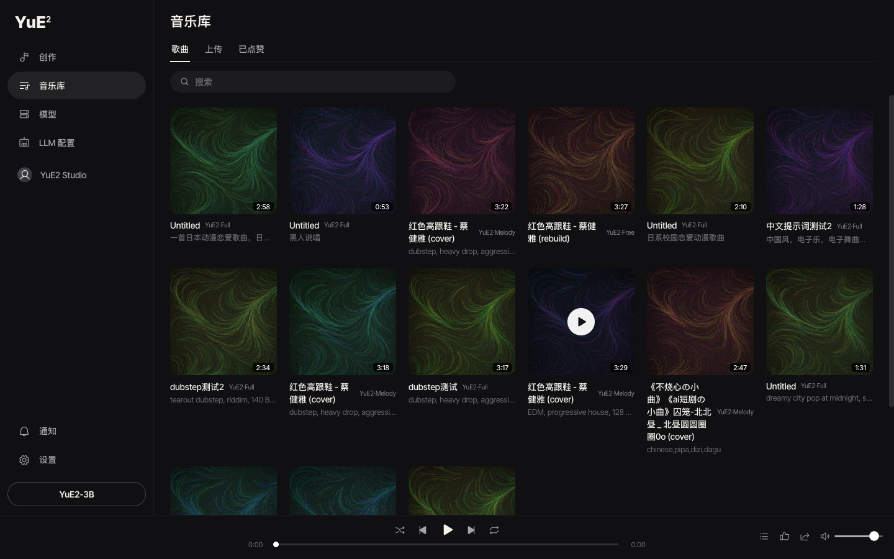

# YuE2 Studio

> **本地音乐生成工作台**：输入歌词与风格，生成整首歌（人声 + 伴奏）。
> 基于 [YuE2](https://github.com/multimodal-art-projection/YuE) 模型做工程化封装：网页界面、模型管理、LLM 增强、自包含一键包、Windows CUDA / macOS MLX 加速。

**当前版本 v0.1.11** · macOS Apple Silicon / Windows x64 · 代码 [Apache-2.0](LICENSE) · 模型权重见 [MODEL_LICENSE](MODEL_LICENSE)



## 这是什么

**YuE2 Studio** 是 YuE2 的本地网页工作台。模型能力来自上游 YuE2（M·A·P）：

- 一个 **AR–NAR Mixture-of-Transformers** 骨干先写出可编辑的 **ABC 符号化计划**（旋律 + 和弦），再生成语义 token 与声学 latent，最后由 VAE 解码为 **48 kHz 立体声**音频——一次生成完整歌曲，而不是拼接片段。
- 创作 / 翻唱 / 编辑的区别只在于乐谱来源：模型自己写、从录音转录、或你手动编辑后的乐谱。


本仓库在上游模型之上补齐了**本地使用的完整链路**：

| 能力 | 说明 |
|---|---|
| 🖥️ **网页工作台** | 创作（简单/高级）、音乐库、模型、LLM 配置、设置；中英双语、暗色三栏界面 |
| 📦 **自包含一键包** | macOS / Windows 各一个包：内置便携 Python + 全部依赖，**双击直接打开网页，无需安装 Python、无需联网装依赖** |
| 🧠 **模型管理器** | 模型不随包：应用内「模型」页按需下载，**国内镜像（hf-mirror.com）/ 国际直连（huggingface.co）一键切换**，断点续传、进度、取消、sha256 校验 |
| 🇨🇳 **中文风格提示词** | 中文 `style` 自动翻译为英文标签（优先 LLM，回退内置词典），`--style-language en\|off` 可关闭 |
| ✨ **LLM 增强与试聊** | 任意 OpenAI 兼容端点（DeepSeek / 通义千问 / 智谱 / Kimi / MiniMax / OpenAI / Ollama / 自定义），配置后魔法棒可把描述扩写成词表标签，页面内可直接试聊 |
| 🎤 **翻唱与改编** | 上传音频 → SheetSage2 转录为乐谱 → 用新风格重新演绎（翻唱）/ 保留乐谱重新编曲（Remix） |
| ⚡ **平台加速** | macOS Apple Silicon：MLX 引擎（4bit/8bit/bf16 三档，速度与内存占用不同）；Windows：NVIDIA 显卡可安装**CUDA 加速套件**（约 2.9 GB，模型页下载，重启生效） |
| ⌨️ **CLI 与 Python API** | `yue2 generate` / `yue2 batch` / `yue2 doctor`；`YuE2Pipeline` 分阶段 API |

## 快速开始：一键包（推荐）

1. 打开 [Releases](https://github.com/Goldloli/YuE2-with-llm/releases)：
   - **版本 tag（如 `v0.1.11`）**：正式版本，推荐；
   - **`oneclick-latest`**：滚动最新构建，适合尝鲜/排查。
2. 下载对应平台的包（每个包只含自己平台的启动器）：

   | 平台 | 包 | 启动器 | 体积 |
   |---|---|---|---|
   | macOS Apple Silicon | `yue2-studio-oneclick-<日期>-macos.zip` | `start.command` | 约 346 MB |
   | Windows x64 | `yue2-studio-oneclick-<日期>-win-x64.zip` | `start.bat` | 约 272 MB |

3. 解压后双击启动器（macOS 首次可能需要右键 → 打开，或 `chmod +x start.command`）。
   **包内自带 Python 运行时与依赖，不联网、不安装任何东西**，数秒后浏览器自动打开 `http://127.0.0.1:9086`。
   > 默认端口 **9086**（不再使用上游默认的 7860）。如与本机其它服务冲突，可用环境变量或启动器参数换端口：
   > `YUE2_PORT=9090 ./start.command`（Windows：`set YUE2_PORT=9090` 后运行 `start.bat`），或 `./start.command --port 9090`。
4. 页面停在「模型」页：选择下载源（**国内镜像** / **国际直连**），下载「核心模型」（约 7.3 GB），完成后即可创作。
5. Windows + NVIDIA 显卡：在同一页安装 **CUDA 加速套件**（约 2.9 GB，分卷下载、断点续传），装完**重启应用**生效。

**校验完整性**（可选但推荐）：

```bash
# macOS
shasum -a 256 yue2-studio-oneclick-20261027-macos.zip
# Windows
certutil -hashfile yue2-studio-oneclick-20261027-win-x64.zip SHA256
```

与同目录 `*.sha256` 对照即可。

**机器要求**：macOS Apple Silicon（建议 16 GB+ 统一内存）；Windows x64（NVIDIA BF16 显卡体验最佳，纯 CPU 可运行但很慢）；磁盘建议预留 15 GB+（包约 1.1 GB + 核心模型 7.3 GB + 可选组件）。

## 从源码运行（开发）

要求 Python ≥ 3.10。

```bash
git clone https://github.com/Goldloli/YuE2-with-llm.git
cd YuE2-with-llm
python3.12 -m venv .venv && source .venv/bin/activate     # Windows: .venv\Scripts\activate
python -m pip install -U pip
python -m pip install -e ".[web]"
python tools/start.py        # 打开 http://127.0.0.1:9086（可用 --port / YUE2_PORT 覆盖）
```

也可以先 `python tools/bootstrap.py --yes` 自动准备虚拟环境（模型仍然在应用内下载）。

**CLI 与 Python API**（模型已经下载到 `models/` 后）：

```bash
yue2 doctor                                          # 环境与模型自检
yue2 generate --request examples/song.json --output outputs/first-song
yue2 batch --input my-requests.jsonl --concurrency 1 # JSONL：每行一个请求（id 需唯一）
```

```python
import json
from pathlib import Path
from yue2 import YuE2Pipeline

request = json.loads(Path("examples/song.json").read_text(encoding="utf-8"))
with YuE2Pipeline.from_pretrained("m-a-p/YuE2-3B", device="cuda") as pipe:
    song = pipe(**request)
    song.save_artifacts("outputs/my-song")
    print(song.truncated)
```

| 设置 | 行为 |
|---|---|
| `cot="full"`（默认） | 生成可编辑的旋律 + 和弦乐谱计划 |
| `cot="melody"` | 只保留旋律，伴奏自由发挥（翻唱推荐） |
| `cot="off"` | 直接用歌词 + 风格生成 |
| `abc=...` | 自带 `full` / `melody` 模式的乐谱 |

命令行下载模型（与页面等价）：

```bash
python tools/hf_download.py core                       # 核心模型（默认国内镜像）
python tools/hf_download.py core --source huggingface  # 国际直连
python tools/hf_download.py extras                     # 解码器 + Realaudio + LoRA
python tools/hf_download.py transcribe                 # 翻唱转录（SheetSage2 + MERT）
python tools/hf_download.py mlx-8bit                   # macOS MLX 变体（mlx-bf16 / mlx-4bit）
```

**测试**：`pytest`（仓库测试套件）。

## 模型与下载渠道

模型**不随一键包分发**，全部在应用内「模型」页或命令行按需下载：

| 组件 | 内容 | 体积 |
|---|---|---|
| 核心模型（必需） | YuE2-3B + YuE2-Vae | 约 7.3 GB |
| 解码器 | Vae-legacy + Merge 0.666 | 约 1.0 GB |
| 扩展工具 | Realaudio 重建包 + 3 个 LoRA 风格 | 约 0.8 GB |
| 音频转录 | SheetSage2 + MERT（翻唱/上传用） | 约 2.7 GB |
| MLX 引擎（仅 macOS） | 4bit / 8bit / bf16 三档 | 约 3.4 / 4.2 / 7.0 GB |
| CUDA 加速套件（仅 Windows） | cu128 torch 运行时（NVIDIA 显卡） | 约 2.9 GB |

| 下载源 | 端点 | 适用网络 |
|---|---|---|
| 国内镜像（默认） | `hf-mirror.com` | 中国大陆，直连即可 |
| 国际直连 | `huggingface.co` | 海外，或可自由访问外网 |

选择会持久化在本机设置（`web/data/settings.json`），页面切换与命令行 `--source` 共用同一份配置；下载支持断点续传、取消与 sha256 校验，并支持**多个组件同时下载**（最多 3 个，进度/取消互不影响）。

## 自包含一键包是怎么构建的（开发者）

```bash
python packaging/build_package.py --platform macos     # → oneclick-packages/macos/…-macos.zip
python packaging/build_package.py --platform win-x64   # → oneclick-packages/win-x64/…-win-x64.zip
python packaging/build_package.py --platform macos --runtime slim   # 开发用瘦包（无内置运行时）
python packaging/smoke_package.py oneclick-packages/macos/*.zip      # 条目冒烟 + .sha256
python packaging/smoke_bundle.py  oneclick-packages/macos/*.zip      # 真冒烟：包内 Python 起服务
```

- 默认构建会把 [python-build-standalone](https://github.com/astral-sh/python-build-standalone) 便携 Python 解到包内 `runtime/`，依赖 `pip install --target` 到 `envs/web/`（macOS 另有 `envs/mlx/`）；
- 平台专用：macOS 包只含 `start.command`，Windows 包只含 `start.bat`（另一平台启动器是构建/冒烟红线）；
- 便携 Python 与 pip wheel 缓存在 `YUE2_ONECLICK_CACHE`；
- Windows CUDA 套件由 `packaging/build_cuda_kit.py` 构建（裁剪后的 cu128 torch 树 + 逐文件 manifest + 分卷），发布到独立 release `cuda-kit-cu128-torch<版本>`，应用内下载校验后注入。

**CI 与发布**：

- `oneclick.yml`：push main → 双平台构建 + 真冒烟 → 覆盖滚动 release `oneclick-latest`；
- `oneclick-release.yml`：push `v*` tag → 草稿 release → macOS / Windows 并行构建+冒烟+上传 → 双绿后转正式；
- `cuda-kit.yml`：手动/tag 构建 Windows CUDA 套件并发布。

发布约定：push 代码后告知版本号，执行 `git tag vN && git push origin vN`，其余自动完成。

## 仓库结构

```
src/yue2/            # 模型推理核心（pipeline / protocol / tokenizer / 采样）
web/                 # FastAPI 服务 + web/static 前端（界面基线见 docs/ui-baseline/）
packaging/           # 一键包构建、冒烟、启动器、CUDA 套件构建
tools/               # 启动/引导、模型下载、MLX 推理脚本、环境工具
skills/yue2-music/   # 面向 AI agent 的 YuE2 技能包（生成/翻唱/编辑/转录）
tests/               # pytest 测试套件
docs/                # 生成/翻唱/编辑/评测文档、UI 基线、技术报告
examples/            # 请求样例
openspec/            # 规格与变更记录
```

## 文档

| 文档 | 内容 |
|---|---|
| [packaging/使用说明.md](packaging/使用说明.md) | 一键包使用说明（下载、启动、模型、CUDA 套件、FAQ） |
| [docs/generation.md](docs/generation.md) | 生成指南：风格/歌词、cot 模式、解码器 |
| [docs/covers.md](docs/covers.md) | 翻唱：转录 → 旋律乐谱 → 新风格演绎 |
| [docs/editing.md](docs/editing.md) | 编辑与迭代 |
| [docs/realaudio.md](docs/realaudio.md) | Realaudio：音频 → 语义 token |
| [docs/benchmarks.md](docs/benchmarks.md) | 上游 YuE2 的评测结果（WildSongBench 等） |
| [docs/style-terms.md](docs/style-terms.md) | 内置中文风格词表 |
| [skills/yue2-music/](skills/yue2-music/) | AI agent 技能包（含翻唱/器乐生成） |
| [AGENTS.md](AGENTS.md) | 本仓库的开发约定（改动工作流、前端冻结、发布流程） |

## 许可

| 使用场景 | 条款 |
|---|---|
| **个人用户、内容创作者、音乐人** | 免费使用 YuE2，并可对生成作品进行商业变现，**无需向模型作者支付费用或版税** |
| **学术研究与教育** | 免费用于**非商业**用途 |
| **公司商业使用** | 模型权重需联系上游团队洽谈商业许可（见 [MODEL_LICENSE](MODEL_LICENSE)） |

我们强烈建议（但非强制）在分享生成作品时标注 **YuE2** 或使用 **#YuE2**。

**负责任使用**：附加创作者许可禁止违法、有害、欺骗性或不道德用途；YuE2 按「现状」提供，**不附带任何担保**；使用者需对自己的输入、输出与使用方式负责，责任限制见[完整条款](MODEL_LICENSE)。

**代码 / 技能包 / 文档**：[Apache-2.0](LICENSE)。**模型权重**：[CC BY-NC 4.0 附加个人创作者许可](MODEL_LICENSE)。

*Copyright (c) 2026 the YuE2 authors. 第三方组件（字体、图标、移植代码等）见 [THIRD_PARTY_NOTICES.md](THIRD_PARTY_NOTICES.md)，历史版本保留各自许可。*

## 致谢与相关项目

- **[YuE2](https://github.com/multimodal-art-projection/YuE)**（M·A·P / HKUST 等）——模型、训练方法、技术报告与示例素材均来自上游；本项目只做本地化工程封装。上游还有 [在线 Demo](https://yue.noizai.net/)、[ComfyUI 节点](https://github.com/Comfy-Org/workflow_templates/blob/main/templates/audio_yue2_text2music.json)、[Maestro](https://github.com/Blizaine/Maestro)、[YuE2-Turbo](https://github.com/NoizAI/YuE2-Turbo) 等生态项目。
- **[SheetSage2](https://huggingface.co/m-a-p/SheetSage2) / [MERT2](https://huggingface.co/m-a-p/MERT-v2-FullSong)** —— 翻唱转录与音频特征。
- **[ASRbox](https://github.com/Goldloli/asrbox)**（MIT）—— Windows CUDA 加速套件的下载/校验/注入流程参考其实现。
- **Inter Tight**（SIL OFL 1.1）、**Phosphor Icons**（MIT）—— 界面字体与图标。

## 引用

使用 YuE2 模型或生成内容时，请引用上游 [YuE2 论文](https://arxiv.org/abs/2609.33757)；使用翻唱转录时请引用 [SheetSage2 论文](https://arxiv.org/abs/2610.05336)。完整 BibTeX（YuE2 / SheetSage2 / MERT / YuE）见上游 [README 的 Citation 一节](https://github.com/multimodal-art-projection/YuE#citation)。

```bibtex
@article{yuan2026yue2,
  title = {{YuE2}: Unifying Symbolic and Audio Music Generation at Frontier Quality},
  author = {Yuan, Ruibin and Pan, Jiahao and Jiang, Junyan and Wu, Zhiyue and Zhou, Ziya and Sun, Jiankai and Li, Yizhi and Zhang, Ge and Gu, Yicheng and Tian, Zeyue and Dai, Junyu and Lin, Hanfeng and Li, Kai and Wu, Shangda and Liu, Xuanjie and Wang, Jiaming and Liu, Zihan and Wang, Yue and Ma, Yinghao and Yin, Hanzhi and Chen, Kangrui and Zhang, Xinyue and Ma, Ziyang and Liao, Mengqi and Zhao, Hejia and Huang, Guowei and Yan, Chao and Ke, Lei and Yu, Jianwei and Liu, Bei and Guo, Joe and Xue, Liumeng and Xia, Gus and Xue, Wei and Guo, Yike},
  journal = {arXiv preprint arXiv:2609.33757},
  year = {2026},
  eprint = {2609.33757},
  archivePrefix = {arXiv},
  primaryClass = {eess.AS},
  url = {https://arxiv.org/abs/2609.33757}
}
```

使用翻唱 / 转录（SheetSage2）时另请引用：

```bibtex
@misc{jiang2026sheetsage2,
  title = {{SheetSage2}: Coherent Lead-Sheet Transcription with Synthetic Supervision},
  author = {Jiang, Junyan and Yuan, Ruibin and Pan, Jiahao and Xue, Wei and Guo, Yike and Xia, Gus and LeCun, Yann},
  year = {2026},
  eprint = {2610.05336},
  archivePrefix = {arXiv},
  primaryClass = {cs.SD},
  url = {https://arxiv.org/abs/2610.05336}
}
```
